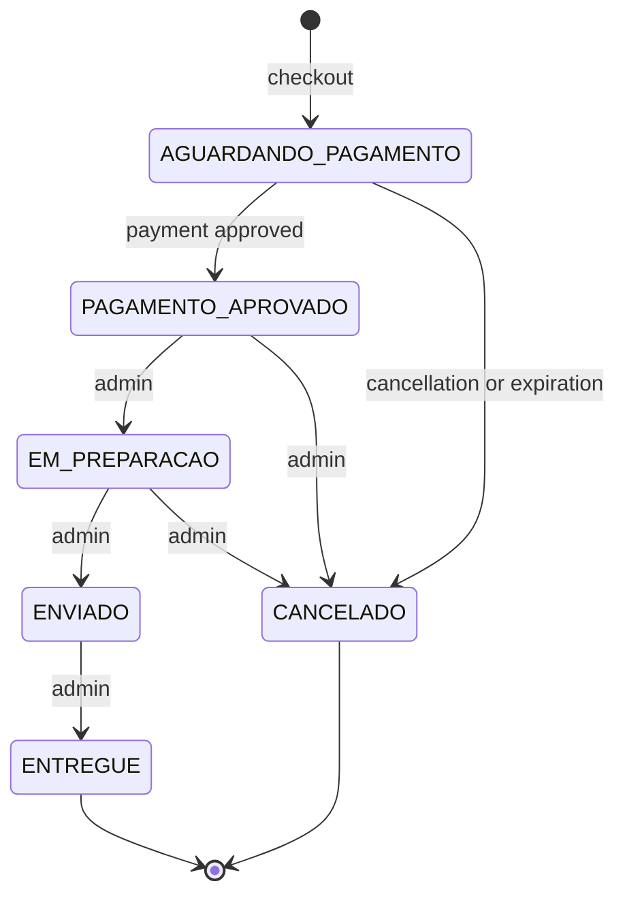

# 🛒 MarketFlow API

[](https://github.com/YuriErnani/marketflow/actions/workflows/ci.yml)

**MarketFlow** is a **RESTful e-commerce API** built with **Java** and **Spring Boot**. Customers browse the catalog, fill their cart, place orders and pay for them, while administrators manage categories, products, stock and order fulfillment.

The project was designed to simulate the concerns of a real commercial system: **data consistency**, **concurrency** on the last item in stock, **idempotent payments**, **JWT security** and an automated **CI/CD pipeline**, from the first commit to the deploy.

🌐 **Live demo:** [Swagger UI](https://marketflow-xvjb.onrender.com/swagger-ui.html)

> ⏳ The demo runs on Render's free plan. After 15 minutes without traffic, the first request may take around 1 minute while the application wakes up.

> 🇧🇷 The API was built in Portuguese, so routes and JSON fields use Portuguese names (for example, `produtos` = products and `pedidos` = orders).


## 🚀 Features

### 👤 Users and authentication
- ✅ Public customer registration, always with the `CLIENTE` (customer) role.
- ✅ JWT login, with tokens valid for 2 hours.
- ✅ View and update your own account, change password and deactivate the account.
- ✅ Deactivated accounts lose access immediately, even with a token that has not expired.
- ✅ First administrator created automatically on startup from environment variables.

### 🏷️ Catalog
- ✅ Categories and products managed by administrators, with public read access.
- ✅ Paginated listing with name search, category and price range filters, and sorting.
- ✅ Inactive products are hidden from the public.
- ✅ Customers see whether a product is available, but not the exact stock quantity.

### 📦 Stock
- ✅ Separate **available** and **reserved** quantities.
- ✅ Stock entries and a complete movement history.

### 🛒 Cart
- ✅ One cart per customer, with subtotals and total always calculated from current server prices.
- ✅ Stock availability checked when adding items.

### 🧾 Orders
- ✅ Checkout with a snapshot of each item's name and price.
- ✅ Stock reserved at checkout and written off when the payment is approved.
- ✅ Cancellation releases or returns the stock, depending on the order status.
- ✅ Unpaid orders automatically expire after 30 minutes.

### 💳 Payments (simulated)
- ✅ Simulated approval or rejection, with no card data stored.
- ✅ Idempotency through the `Idempotency-Key` header: repeating a request never charges twice.
- ✅ Approved payments are refunded when a paid order is cancelled.

### 🔄 Order lifecycle



| Status | Meaning |
| :--- | :--- |
| `AGUARDANDO_PAGAMENTO` | Awaiting payment |
| `PAGAMENTO_APROVADO` | Payment approved |
| `EM_PREPARACAO` | Being prepared |
| `ENVIADO` | Shipped |
| `ENTREGUE` | Delivered |
| `CANCELADO` | Cancelled |


## 🛠️ Technologies Used

- ☕ **Java 21** – records, switch expressions and `BigDecimal` for money
- 🌱 **Spring Boot 4** – Web MVC, Data JPA, Security, Validation and Actuator
- 🔐 **Spring Security + JWT** (`java-jwt`) – stateless authentication with a custom filter and BCrypt
- 🗄️ **PostgreSQL 17** + **Hibernate** – persistence and object-relational mapping
- 🧱 **Flyway** – versioned database migrations
- 📚 **springdoc-openapi** – Swagger/OpenAPI 3 documentation
- 🐳 **Docker** + **Docker Compose** – containerized application and database
- ⚙️ **GitHub Actions** – continuous integration
- ☁️ **Render** + **Neon** – application and database hosting
- 🧪 **Postman** – end-to-end API tests
- ✂️ **Lombok** – less boilerplate code
- 📦 **Maven** – dependency management and build


## 🏗️ Architecture

The project follows a **modular monolith** approach: a single application organized by business area. Each module has its own layers, and modules talk to each other through services, never by accessing another module's repository.

```text
HTTP client → JWT filter → Controller → Service → Repository → PostgreSQL
```

| Layer | Responsibility |
| :--- | :--- |
| `Controller` | Receives the request, validates the DTO and returns the response |
| `Service` | Business rules and transactions |
| `Entity` | State and the rules that protect its own consistency |
| `Repository` | Database access |

Modules: `usuario` (users), `categoria` (categories), `produto` (products), `estoque` (stock), `carrinho` (cart), `pedido` (orders) and `pagamento` (payments), plus `infra`, with shared security, configuration, validation and error handling.


## 💡 Technical Decisions

| Challenge | Solution |
| :--- | :--- |
| 🔒 Two customers buying the last item at the same time | Pessimistic locking (`SELECT ... FOR UPDATE`) on stock. The second purchase waits for the first one and receives `409` |
| 🔁 Deadlocks between orders with several products | Stock rows are always locked in the same order, by product ID |
| 💳 Payment repeated after a network failure | Unique idempotency key in the database. The retry returns the original result with `200` |
| 🧾 Price changed after the purchase | Order items keep the name and price from the moment of purchase |
| 🛡️ Client sending fake prices | The client only sends products, quantities and address. All amounts are calculated on the server |
| ⏱️ Unpaid orders holding stock | Scheduled task that cancels orders pending for more than 30 minutes, each one in its own transaction |
| ⚡ N+1 query problem | `@EntityGraph` on queries with relationships and batch (`IN`) queries for products and stock |
| 🗄️ Database evolution | Versioned Flyway migrations, with Hibernate set to `ddl-auto=validate` |
| 💰 Monetary values | `BigDecimal` in the application and `NUMERIC` in the database |
| ❗ Error responses | Problem Details (RFC 9457) for every error, including `401` and `403` |
| 🔗 Circular dependency between orders and payments | One-way dependency: `PedidoService` coordinates `PagamentoService` |
| 🔑 Long passwords in BCrypt | Custom validation that limits passwords to 72 bytes, not 72 characters |
| 🕵️ Accessing another customer's data | Returns `404` instead of `403`, so the resource's existence is not revealed |


## 📋 Prerequisites

To run this application you need:

- ✅ Git
- ✅ [Docker Desktop](https://www.docker.com/products/docker-desktop/) **or** Java JDK 21 + PostgreSQL


## 📥 How to Configure the Project

### 1. Clone the Repository

```bash
git clone https://github.com/YuriErnani/marketflow.git
cd marketflow
```

### 2. Create the Environment File

```bash
cp .env.example .env
```

> On Windows, use `copy .env.example .env`.

Then fill in the values in `.env`. This file is ignored by Git and must never be committed.

### 3. Run with Docker Compose (recommended)

```bash
docker compose up -d --build
```

The API will be available at `http://localhost:8080`. Flyway creates the tables and the administrator is created automatically.

```bash
docker compose ps          # container status
docker compose logs -f app # application logs
docker compose down        # stop everything, keeping the data
```

### 3.1 Or Run Locally

With Java 21 and a PostgreSQL database already created:

```bash
./mvnw spring-boot:run
```

> On Windows, use `mvnw.cmd spring-boot:run`.


## 🔑 Environment Variables

| Variable | Required | Description |
| :--- | :--- | :--- |
| `DB_NAME` | ✅ | Database name |
| `DB_USER` | ✅ | Database user |
| `DB_PASSWORD` | ✅ | Database password |
| `JWT_SECRET` | ✅ | Key used to sign tokens |
| `ADMIN_EMAIL` | ➖ | First administrator's email |
| `ADMIN_PASSWORD` | ➖ | First administrator's password |
| `DB_HOST` | ➖ | Database host (default: `localhost`) |
| `DB_PORT` | ➖ | Database port (default: `5432`) |
| `DB_URL` | ➖ | Full JDBC URL. Replaces `DB_HOST`, `DB_PORT` and `DB_NAME` |
| `PEDIDO_EXPIRACAO_MINUTOS` | ➖ | Minutes before unpaid orders expire (default: `30`) |
| `PORT` | ➖ | Application port (default: `8080`) |

To generate a random JWT secret with PowerShell:

```powershell
$bytes = New-Object byte[] 32
[Security.Cryptography.RandomNumberGenerator]::Create().GetBytes($bytes)
[Convert]::ToBase64String($bytes)
```


## 📖 API Documentation

With the application running, the interactive documentation is available at:

- 📚 **Swagger UI:** `http://localhost:8080/swagger-ui.html`
- 📄 **OpenAPI (JSON):** `http://localhost:8080/v3/api-docs`

To call protected routes, log in, click **Authorize** and paste the token. Every route starts with `/api/v1`.

| Icon | Access |
| :---: | :--- |
| 🌍 | Public |
| 👤 | Any authenticated user |
| 🛍️ | Customer |
| 🛡️ | Administrator |


### 🔐 Authentication

#### 🌍 Register a Customer

```http
  POST /api/v1/auth/cadastro
```

| Parameter | Type | Description |
| :--- | :--- | :--- |
| `nome` | `string` | **Mandatory**. Customer's name, up to 120 characters |
| `email` | `string` | **Mandatory**. A valid, unique email |
| `senha` | `string` | **Mandatory**. Password with at least 8 characters and up to 72 bytes |

#### 🌍 Log In

```http
  POST /api/v1/auth/login
```

| Parameter | Type | Description |
| :--- | :--- | :--- |
| `email` | `string` | **Mandatory**. Registered email |
| `senha` | `string` | **Mandatory**. Password |

```json
{
  "token": "eyJhbGciOiJIUzI1NiIs...",
  "tipo": "Bearer"
}
```


### 👤 My Account

| Method | Route | Description |
| :--- | :--- | :--- |
| `GET` | `/api/v1/usuarios/minha-conta` | 👤 View your account |
| `PUT` | `/api/v1/usuarios/minha-conta` | 👤 Update `nome` and `email` |
| `PUT` | `/api/v1/usuarios/minha-conta/senha` | 👤 Change password with `senhaAtual` and `novaSenha` |
| `DELETE` | `/api/v1/usuarios/minha-conta` | 👤 Deactivate your account |


### 🏷️ Categories

| Method | Route | Description |
| :--- | :--- | :--- |
| `GET` | `/api/v1/categorias` | 🌍 List categories |
| `GET` | `/api/v1/categorias/{id}` | 🌍 Get a category |
| `POST` | `/api/v1/categorias` | 🛡️ Create a category with `nome` and `descricao` |
| `PUT` | `/api/v1/categorias/{id}` | 🛡️ Update a category |


### 📦 Products

#### 🌍 List Products

```http
  GET /api/v1/produtos
```

| Parameter | Type | Description |
| :--- | :--- | :--- |
| `nome` | `string` | **Optional**. Search by name, case-insensitive |
| `categoriaId` | `long` | **Optional**. Filter by category |
| `precoMin` | `BigDecimal` | **Optional**. Minimum price |
| `precoMax` | `BigDecimal` | **Optional**. Maximum price |
| `page` | `integer` | **Optional**. Page number, starting at 0 |
| `size` | `integer` | **Optional**. Page size. The default is 10 and the maximum is 50 |
| `sort` | `string` | **Optional**. `nome`, `preco` or `criadoEm`, such as `preco,desc` |

#### 🛡️ Create a Product

```http
  POST /api/v1/produtos
```

| Parameter | Type | Description |
| :--- | :--- | :--- |
| `nome` | `string` | **Mandatory**. Product name, up to 120 characters |
| `descricao` | `string` | **Optional**. Description, up to 1000 characters |
| `preco` | `BigDecimal` | **Mandatory**. Price greater than zero, with up to 2 decimal places |
| `categoriaId` | `long` | **Mandatory**. An existing category |

| Method | Route | Description |
| :--- | :--- | :--- |
| `GET` | `/api/v1/produtos/{id}` | 🌍 Get a product |
| `PUT` | `/api/v1/produtos/{id}` | 🛡️ Update a product |
| `PATCH` | `/api/v1/produtos/{id}/ativacao` | 🛡️ Activate or deactivate it with `{"ativo": true}` |


### 📊 Stock

| Method | Route | Description |
| :--- | :--- | :--- |
| `GET` | `/api/v1/estoque/{produtoId}` | 🛡️ Available and reserved quantities |
| `POST` | `/api/v1/estoque/{produtoId}/entradas` | 🛡️ Add stock with `quantidade` (1 to 10,000) |
| `GET` | `/api/v1/estoque/{produtoId}/movimentacoes` | 🛡️ Paginated movement history |


### 🛒 Cart

#### 🛍️ Add an Item

```http
  POST /api/v1/carrinho/itens
```

| Parameter | Type | Description |
| :--- | :--- | :--- |
| `produtoId` | `long` | **Mandatory**. An active product with stock |
| `quantidade` | `integer` | **Mandatory**. From 1 to 100. Adds to the existing quantity |

| Method | Route | Description |
| :--- | :--- | :--- |
| `GET` | `/api/v1/carrinho` | 🛍️ View items, subtotals and total |
| `PUT` | `/api/v1/carrinho/itens/{produtoId}` | 🛍️ Set an item's `quantidade` |
| `DELETE` | `/api/v1/carrinho/itens/{produtoId}` | 🛍️ Remove an item |


### 🧾 Orders

#### 🛍️ Checkout

```http
  POST /api/v1/pedidos
```

| Parameter | Type | Description |
| :--- | :--- | :--- |
| `enderecoEntrega` | `string` | **Mandatory**. Delivery address, up to 500 characters |

Items, quantities and prices come from the cart and the server, never from the request.

#### 🛡️ Update the Status

```http
  PATCH /api/v1/pedidos/{id}/status
```

| Parameter | Type | Description |
| :--- | :--- | :--- |
| `status` | `string` | **Mandatory**. The next step: `EM_PREPARACAO`, `ENVIADO` or `ENTREGUE` |

| Method | Route | Description |
| :--- | :--- | :--- |
| `GET` | `/api/v1/pedidos` | 👤 List orders. Customers see their own, admins see all |
| `GET` | `/api/v1/pedidos/{id}` | 👤 Order details with items |
| `POST` | `/api/v1/pedidos/{id}/cancelamento` | 👤 Cancel. Customers can only cancel orders awaiting payment |


### 💳 Payments

#### 🛍️ Pay for an Order

```http
  POST /api/v1/pedidos/{id}/pagamentos
```

| Parameter | Type | Description |
| :--- | :--- | :--- |
| `Idempotency-Key` | `header` | **Mandatory**. Unique key for each payment attempt, up to 100 characters |
| `resultadoSimulado` | `string` | **Mandatory**. `APROVADO` (approved) or `RECUSADO` (rejected) |

| Situation | Response |
| :--- | :--- |
| New key | Processes the payment and returns `201` |
| Same key, same order | Returns the original payment with `200`, without processing it again |
| Same key, another order | `409` |
| Order not awaiting payment | `409` |

| Method | Route | Description |
| :--- | :--- | :--- |
| `GET` | `/api/v1/pedidos/{id}/pagamentos` | 👤 List the order's payment attempts |


### ❗ Error Format

Every error follows the Problem Details standard (RFC 9457):

```json
{
  "type": "about:blank",
  "title": "Estoque Insuficiente",
  "status": 409,
  "detail": "Quantidade solicitada indisponível em estoque.",
  "instance": "/api/v1/pedidos"
}
```


## 🧪 Tests

### 📮 Postman Collection

The [`postman`](postman) folder contains an end-to-end collection that tests the whole API, from authentication to product availability, with hundreds of automatic assertions.

1. Import `postman/marketflow.postman_collection.json` into Postman.
2. Create an environment with `adminEmail` and `adminSenha`, matching your `.env`, and select it.
3. With the API running, execute the collection with the **Runner**.

Each run creates its own data, so the collection can be executed repeatedly without cleaning the database.

### ⚙️ Continuous Integration

On every `push` or pull request to `main`, GitHub Actions:

1. ✅ Starts a temporary PostgreSQL database.
2. ✅ Builds the project and starts the application, applying every migration on an empty database and validating the entities.
3. ✅ Builds the Docker image.

When CI passes, Render deploys the new version automatically.


## 📁 Project Structure

```text
marketflow
├── .github/workflows/ci.yml        # CI pipeline
├── postman/                        # API test collection
├── src/main/java/br/com/marketflow
│   ├── carrinho/                   # Cart
│   ├── categoria/                  # Categories
│   ├── estoque/                    # Stock
│   ├── infra/                      # Security, configuration, validation and errors
│   ├── pagamento/                  # Payments
│   ├── pedido/                     # Orders
│   ├── produto/                    # Products
│   └── usuario/                    # Users
├── src/main/resources
│   ├── db/migration/               # Flyway migrations (V1 to V8)
│   └── application.properties
├── .env.example
├── compose.yaml
├── Dockerfile
└── pom.xml
```

Each business module follows the same structure: `controller`, `service`, `repository`, `entity`, `dto` and `exception`.


## 🔭 Next Steps

- 💳 Integrate a real payment gateway in sandbox mode, such as Mercado Pago or Stripe.
- 🔑 Invalidate existing tokens after a password change.
- 🚦 Limit login attempts to prevent brute-force attacks.
- 🔄 Add refresh tokens.
- 🧪 Add unit and integration tests in Java.


## 🏁 Conclusion

Building MarketFlow was an opportunity to apply, in a complete project, the technologies a Java back-end developer uses day to day: Spring Boot, Spring Security with JWT, Spring Data JPA, PostgreSQL, Flyway, Docker and CI/CD. Beyond making it work, the goal was to understand why each technology is there and how they fit together, from the first commit to the deploy.


## 👨‍💻 Author

Developed by **Yuri Ernani** – [GitHub](https://github.com/YuriErnani)
