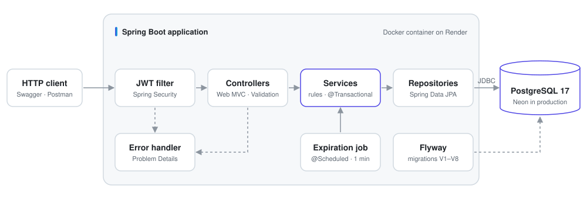
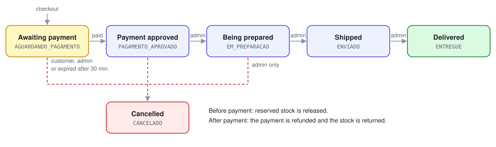

# MarketFlow API

A RESTful e-commerce backend built with Java 21 and Spring Boot 4, focused on data consistency, concurrency control and secure, stateless authentication.

[](https://github.com/YuriErnani/marketflow/actions/workflows/ci.yml)


[Live demo](https://marketflow-xvjb.onrender.com/swagger-ui.html) · [Getting started](#getting-started) · [API reference](#api-reference) · [Engineering decisions](#engineering-decisions)

> [!NOTE]
> The live demo runs on Render's free tier. After 15 minutes without traffic, the first request can take about a minute while the service wakes up.

## Table of contents

- [Overview](#overview)
- [Architecture](#architecture)
- [Order lifecycle](#order-lifecycle)
- [Engineering decisions](#engineering-decisions)
- [Tech stack](#tech-stack)
- [Getting started](#getting-started)
- [Configuration](#configuration)
- [API reference](#api-reference)
- [Testing](#testing)
- [CI/CD and deployment](#cicd-and-deployment)
- [Project structure](#project-structure)
- [Limitations and roadmap](#limitations-and-roadmap)

## Overview

MarketFlow covers the full purchase flow of an online store. Customers browse the catalog, manage a cart, place orders and pay for them. Administrators manage categories, products, stock and order fulfillment.

The project goes beyond CRUD and addresses problems that real commercial systems face:

- **Concurrency.** Two customers buying the last unit at the same time never oversell the stock.
- **Idempotency.** A payment retried after a network failure is never processed twice.
- **Consistency.** Prices are calculated on the server and frozen at checkout, and every stock change is recorded.
- **Security.** Stateless JWT authentication, role-based authorization and consistent error responses.
- **Automation.** Every push is built and verified in CI and deployed automatically.

| Domain | Capabilities |
| :--- | :--- |
| Users | Customer sign-up, JWT login (2-hour tokens), account management, deactivation with immediate loss of access, admin bootstrap from environment variables |
| Catalog | Categories and products with paginated search, filtering by category and price range, sorting, and public availability without exposing stock levels |
| Stock | Separate available and reserved quantities, stock entries and a full movement history |
| Cart | One cart per customer, with totals always recalculated from current prices |
| Orders | Checkout with price snapshots, stock reservation, cancellation and automatic expiration of unpaid orders |
| Payments | Simulated approval or rejection, idempotency keys and automatic refunds on cancellation |

> [!NOTE]
> The domain language is Portuguese, so routes and JSON fields use Portuguese names, such as `produtos` (products), `pedidos` (orders) and `estoque` (stock).

## Architecture

MarketFlow is a **modular monolith**: a single deployable application organized by business domain. Each module owns its controllers, services, entities and repositories, and modules communicate only through services, never through another module's repository.

<picture>
  <source media="(prefers-color-scheme: dark)" srcset="docs/images/architecture-dark.svg">
  
</picture>

| Layer | Responsibility |
| :--- | :--- |
| JWT filter | Validates the token and loads the authenticated user into the security context |
| Controller | Maps HTTP requests, validates DTOs and builds responses |
| Service | Business rules and transaction boundaries |
| Entity | Domain state and the invariants that protect it |
| Repository | Data access through Spring Data JPA |

**Modules:** `usuario` (users), `categoria` (categories), `produto` (products), `estoque` (stock), `carrinho` (cart), `pedido` (orders) and `pagamento` (payments). The `infra` package holds shared security, configuration, validation and error handling.

## Order lifecycle

<picture>
  <source media="(prefers-color-scheme: dark)" srcset="docs/images/order-lifecycle-dark.svg">
  
</picture>

- Stock is **reserved** at checkout and **written off** when the payment is approved.
- Customers can cancel only orders awaiting payment. After payment, only administrators can cancel.
- A scheduled job checks for unpaid orders every minute and cancels those older than 30 minutes, each in its own transaction.

## Engineering decisions

| Problem | Decision |
| :--- | :--- |
| Two customers buying the last unit at the same time | Pessimistic locking (`SELECT ... FOR UPDATE`) on stock rows. The second checkout waits for the first and receives `409 Conflict` |
| Deadlocks between orders with several products | Stock rows are always locked in the same order, by product ID |
| Payment retried after a network failure | A unique `Idempotency-Key` stored in the database. A retry returns the original result with `200 OK` |
| Prices changing after a purchase | Order items keep a snapshot of the product name and price |
| Clients sending tampered prices | Requests carry only product IDs, quantities and address. All amounts are calculated on the server |
| Unpaid orders holding stock | Scheduled expiration job, with each order processed in an isolated transaction |
| N+1 queries | `@EntityGraph` on relationship queries and batched `IN` queries for products and stock |
| Schema evolution | Versioned Flyway migrations, with Hibernate set to `ddl-auto=validate` |
| Monetary precision | `BigDecimal` in the application and `NUMERIC` in the database |
| Consistent error responses | Problem Details (RFC 9457) for every error, including `401` and `403` raised by the security filter chain |
| Circular dependency between orders and payments | One-way dependency: `PedidoService` coordinates `PagamentoService` |
| BCrypt's 72-byte input limit | Custom validator that limits passwords by bytes, not characters |
| Probing for other customers' resources | `404 Not Found` instead of `403 Forbidden`, so resource existence is not disclosed |

## Tech stack

| Area | Technology |
| :--- | :--- |
| Language | Java 21 |
| Framework | Spring Boot 4 (Web MVC, Data JPA, Security, Validation, Actuator) |
| Authentication | Spring Security, JWT (`java-jwt`), BCrypt |
| Persistence | PostgreSQL 17, Hibernate, Flyway |
| Documentation | springdoc-openapi (OpenAPI 3, Swagger UI) |
| Build | Maven, Lombok |
| Containers | Docker (multi-stage build), Docker Compose |
| CI/CD | GitHub Actions, Render |
| Database hosting | Neon |
| API testing | Postman |

## Getting started

### Prerequisites

- Git
- [Docker Desktop](https://www.docker.com/products/docker-desktop/), **or** JDK 21 and a PostgreSQL database

### 1. Clone the repository

```bash
git clone https://github.com/YuriErnani/marketflow.git
cd marketflow
```

### 2. Create the environment file

```bash
cp .env.example .env
```

On Windows, use `copy .env.example .env`. Then fill in the values described in [Configuration](#configuration).

> [!IMPORTANT]
> `.env` contains secrets and is ignored by Git. Never commit it.

### 3. Run the application

**With Docker Compose (recommended):**

```bash
docker compose up -d --build
```

This starts PostgreSQL and the API. Flyway creates the schema on startup and the first administrator is created automatically.

```bash
docker compose ps           # container status
docker compose logs -f app  # application logs
docker compose down         # stop the containers and keep the data
```

**Or locally, with JDK 21 and an existing PostgreSQL database:**

```bash
./mvnw spring-boot:run      # on Windows: mvnw.cmd spring-boot:run
```

### 4. Verify

```bash
curl http://localhost:8080/actuator/health
```

```json
{"status":"UP"}
```

Then open the Swagger UI at `http://localhost:8080/swagger-ui.html`.

## Configuration

All settings are provided through environment variables, loaded from `.env` in local development.

| Variable | Required | Default | Description |
| :--- | :---: | :--- | :--- |
| `DB_NAME` | Yes | | Database name |
| `DB_USER` | Yes | | Database user |
| `DB_PASSWORD` | Yes | | Database password |
| `JWT_SECRET` | Yes | | Secret used to sign tokens |
| `ADMIN_EMAIL` | No | | Email of the first administrator |
| `ADMIN_PASSWORD` | No | | Password of the first administrator |
| `DB_HOST` | No | `localhost` | Database host |
| `DB_PORT` | No | `5432` | Database port |
| `DB_URL` | No | | Full JDBC URL. Overrides `DB_HOST`, `DB_PORT` and `DB_NAME` |
| `PEDIDO_EXPIRACAO_MINUTOS` | No | `30` | Minutes before an unpaid order expires |
| `PORT` | No | `8080` | HTTP port |

The administrator is created only when both `ADMIN_EMAIL` and `ADMIN_PASSWORD` are set and no administrator exists yet.

To generate a random JWT secret:

```bash
openssl rand -base64 32
```

```powershell
# PowerShell
$bytes = New-Object byte[] 32
[Security.Cryptography.RandomNumberGenerator]::Create().GetBytes($bytes)
[Convert]::ToBase64String($bytes)
```

## API reference

The complete, interactive reference is available in the Swagger UI at `/swagger-ui.html`, and the OpenAPI document at `/v3/api-docs`. All endpoints are prefixed with `/api/v1`.

### Authentication

Protected endpoints require a bearer token obtained from the login endpoint:

```bash
curl -X POST http://localhost:8080/api/v1/auth/login \
  -H "Content-Type: application/json" \
  -d '{"email": "customer@example.com", "senha": "your-password"}'
```

```json
{
  "token": "eyJhbGciOiJIUzI1NiIs...",
  "tipo": "Bearer"
}
```

```bash
curl http://localhost:8080/api/v1/carrinho \
  -H "Authorization: Bearer <token>"
```

### Endpoints

**Access:** Public, Authenticated (any signed-in user), Customer, Admin.

| Method | Endpoint | Access | Description |
| :--- | :--- | :--- | :--- |
| `POST` | `/auth/cadastro` | Public | Register a customer |
| `POST` | `/auth/login` | Public | Log in and receive a JWT |
| `GET` | `/usuarios/minha-conta` | Authenticated | Get your account |
| `PUT` | `/usuarios/minha-conta` | Authenticated | Update name and email |
| `PUT` | `/usuarios/minha-conta/senha` | Authenticated | Change your password |
| `DELETE` | `/usuarios/minha-conta` | Authenticated | Deactivate your account |
| `GET` | `/categorias` | Public | List categories |
| `GET` | `/categorias/{id}` | Public | Get a category |
| `POST` | `/categorias` | Admin | Create a category |
| `PUT` | `/categorias/{id}` | Admin | Update a category |
| `GET` | `/produtos` | Public | Search products (paginated) |
| `GET` | `/produtos/{id}` | Public | Get a product |
| `POST` | `/produtos` | Admin | Create a product |
| `PUT` | `/produtos/{id}` | Admin | Update a product |
| `PATCH` | `/produtos/{id}/ativacao` | Admin | Activate or deactivate a product |
| `GET` | `/estoque/{produtoId}` | Admin | Get available and reserved quantities |
| `POST` | `/estoque/{produtoId}/entradas` | Admin | Add stock |
| `GET` | `/estoque/{produtoId}/movimentacoes` | Admin | Get the stock movement history (paginated) |
| `GET` | `/carrinho` | Customer | Get the cart with subtotals and total |
| `POST` | `/carrinho/itens` | Customer | Add an item |
| `PUT` | `/carrinho/itens/{produtoId}` | Customer | Set an item's quantity |
| `DELETE` | `/carrinho/itens/{produtoId}` | Customer | Remove an item |
| `POST` | `/pedidos` | Customer | Check out the cart |
| `GET` | `/pedidos` | Authenticated | List orders. Customers see their own and admins see all |
| `GET` | `/pedidos/{id}` | Authenticated | Get an order with its items |
| `POST` | `/pedidos/{id}/cancelamento` | Authenticated | Cancel an order |
| `PATCH` | `/pedidos/{id}/status` | Admin | Advance an order's status |
| `POST` | `/pedidos/{id}/pagamentos` | Customer | Pay for an order |
| `GET` | `/pedidos/{id}/pagamentos` | Authenticated | List an order's payment attempts |

### Product search

`GET /produtos` accepts the following query parameters, all optional:

| Parameter | Description |
| :--- | :--- |
| `nome` | Case-insensitive name search |
| `categoriaId` | Category filter |
| `precoMin`, `precoMax` | Price range |
| `page`, `size` | Zero-based page number and page size (default `10`, maximum `50`) |
| `sort` | `nome` (default), `preco` or `criadoEm`, for example `preco,desc` |

### Idempotent payments

`POST /pedidos/{id}/pagamentos` requires an `Idempotency-Key` header, a unique value of up to 100 characters per payment attempt. The body sets the simulated outcome:

```json
{ "resultadoSimulado": "APROVADO" }
```

| Scenario | Response |
| :--- | :--- |
| New key | `201 Created`, payment processed |
| Same key, same order | `200 OK`, original payment returned without reprocessing |
| Same key, different order | `409 Conflict` |
| Order not awaiting payment | `409 Conflict` |

### Errors

Every error response follows the Problem Details format ([RFC 9457](https://www.rfc-editor.org/rfc/rfc9457)):

```json
{
  "type": "about:blank",
  "title": "Estoque Insuficiente",
  "status": 409,
  "detail": "Quantidade solicitada indisponível em estoque.",
  "instance": "/api/v1/pedidos"
}
```

## Testing

### End-to-end tests

The [`postman`](postman) folder contains a collection that exercises the entire API, from authentication to payments, with hundreds of automated assertions. Each run creates its own data, so it can be executed repeatedly without resetting the database.

1. Import `postman/marketflow.postman_collection.json` into Postman.
2. Create an environment with `adminEmail` and `adminSenha` matching your `.env`, and select it.
3. With the API running locally, run the collection in the **Collection Runner**.

> [!WARNING]
> Run the collection only against a local environment. It creates users, products and orders.

## CI/CD and deployment

On every push and pull request to `main`, the [CI workflow](.github/workflows/ci.yml):

1. Starts a temporary PostgreSQL service.
2. Builds and verifies the project, starting the application against an empty database to apply every migration and validate the entity mappings.
3. Builds the Docker image.

When the checks pass, Render deploys the new version automatically.

| Component | Platform |
| :--- | :--- |
| Application | Render, as a Docker web service |
| Database | Neon, serverless PostgreSQL over SSL |

## Project structure

```text
marketflow
├── .github/workflows/ci.yml       # CI pipeline
├── docs/images/                   # README diagrams
├── postman/                       # End-to-end test collection
├── src/main/java/br/com/marketflow
│   ├── carrinho/                  # Cart
│   ├── categoria/                 # Categories
│   ├── estoque/                   # Stock
│   ├── infra/                     # Security, configuration, validation, error handling
│   ├── pagamento/                 # Payments
│   ├── pedido/                    # Orders
│   ├── produto/                   # Products
│   └── usuario/                   # Users
├── src/main/resources
│   ├── db/migration/              # Flyway migrations (V1 to V8)
│   └── application.properties
├── .env.example
├── compose.yaml
├── Dockerfile
└── pom.xml
```

Business modules follow the same internal layout: `controller`, `service`, `repository`, `entity`, `dto` and `exception`.

## Limitations and roadmap

Known limitations:

- Tokens issued before a password change remain valid until they expire.
- Login attempts are not rate-limited.
- On Render's free tier, the expiration job does not run while the service is asleep. Overdue orders are cancelled on the first run after it wakes up.

Planned improvements:

- [ ] Revoke existing tokens after a password change
- [ ] Rate-limit login attempts
- [ ] Refresh tokens
- [ ] Integration with a real payment gateway in sandbox mode
- [ ] Unit and integration tests in Java

## Author

**Yuri Ernani** · [GitHub](https://github.com/YuriErnani)
