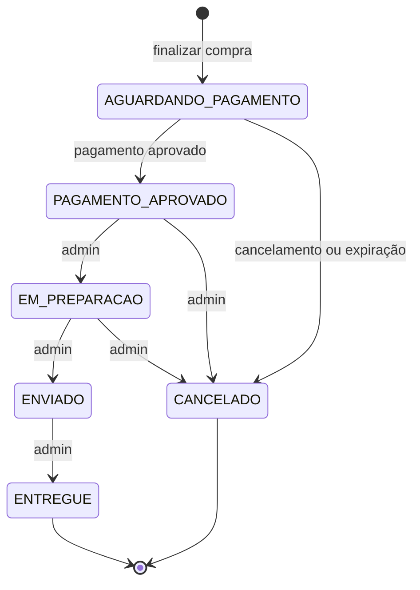

# MarketFlow API

[](https://github.com/YuriErnani/marketflow/actions/workflows/ci.yml)

API REST de e-commerce desenvolvida com **Java** e **Spring Boot**. Clientes consultam o catálogo, montam o carrinho, compram e acompanham seus pedidos; administradores gerenciam categorias, produtos, estoque e o andamento dos pedidos.

O projeto simula as preocupações de um sistema comercial real: consistência dos dados em transações, concorrência na venda da última unidade, pagamentos idempotentes, segurança com JWT e entrega automatizada com CI e deploy.

**Demonstração:** [documentação interativa (Swagger)](https://marketflow-xvjb.onrender.com/swagger-ui.html)

> A demonstração roda no plano gratuito do Render: depois de 15 minutos sem acesso, o primeiro carregamento leva cerca de 1 minuto.

---

## Sumário

- [Tecnologias](#tecnologias)
- [Funcionalidades](#funcionalidades)
- [Arquitetura](#arquitetura)
- [Decisões técnicas](#decisões-técnicas)
- [Como executar](#como-executar)
- [Variáveis de ambiente](#variáveis-de-ambiente)
- [Documentação da API](#documentação-da-api)
- [Exemplos de requisições](#exemplos-de-requisições)
- [Testes](#testes)
- [Estrutura do projeto](#estrutura-do-projeto)
- [Limitações e próximos passos](#limitações-e-próximos-passos)

---

## Tecnologias

| Categoria | Tecnologia |
|---|---|
| Linguagem | Java 21 |
| Framework | Spring Boot 4.1 (Web MVC, Data JPA, Security, Validation, Actuator) |
| Persistência | PostgreSQL 17, Hibernate, Flyway |
| Segurança | JWT (`java-jwt`), BCrypt |
| Documentação | springdoc-openapi (Swagger UI) |
| Infraestrutura | Docker, Docker Compose |
| CI/CD | GitHub Actions, Render (aplicação), Neon (banco) |
| Testes | Coleção do Postman com testes automáticos de ponta a ponta |
| Produtividade | Lombok |

---

## Funcionalidades

### Usuários e autenticação
- Cadastro público de clientes, sempre com o perfil `CLIENTE`.
- Login com JWT válido por 2 horas.
- Consulta e atualização da própria conta, troca de senha e desativação da conta.
- Conta desativada perde o acesso imediatamente, mesmo com um token ainda válido.
- Primeiro administrador criado automaticamente na inicialização, a partir de variáveis de ambiente.

### Catálogo
- Categorias e produtos gerenciados pelo administrador; consulta pública.
- Listagem paginada, com busca por nome, filtros por categoria e faixa de preço e ordenação controlada.
- Produtos inativos ficam ocultos para o público.
- O público vê se um produto está disponível, mas não a quantidade exata em estoque.

### Estoque
- Saldos separados de unidades **disponíveis** e **reservadas**.
- Entradas de mercadoria e histórico completo de movimentações.

### Carrinho
- Um carrinho por cliente, com subtotais e total sempre calculados com os preços atuais do servidor.
- Validação de disponibilidade ao adicionar itens.

### Pedidos
- Finalização da compra com cópia (snapshot) do nome e do preço de cada item.
- Reserva de estoque na compra e baixa na aprovação do pagamento.
- Cancelamento com liberação ou devolução do estoque, conforme o momento.
- Expiração automática de pedidos não pagos após 30 minutos.

### Pagamentos (simulados)
- Aprovação ou recusa simulada, sem dados de cartão.
- Idempotência pelo cabeçalho `Idempotency-Key`: repetir a requisição nunca cobra duas vezes.
- Estorno do pagamento quando um pedido pago é cancelado.

### Ciclo de vida do pedido



| Evento | Estoque disponível | Estoque reservado | Movimentação |
|---|---|---|---|
| Finalizar compra | − quantidade | + quantidade | `RESERVA` |
| Pagamento aprovado | — | − quantidade | `BAIXA` |
| Cancelar antes do pagamento | + quantidade | − quantidade | `LIBERACAO` |
| Cancelar depois do pagamento | + quantidade | — | `DEVOLUCAO` |

---

## Arquitetura

**Monólito modular**: uma única aplicação, organizada por áreas de negócio. Cada módulo tem suas camadas, e a comunicação entre módulos acontece pelos services, nunca acessando diretamente o repository de outro módulo.

```text
Cliente HTTP → Filtro JWT → Controller → Service → Repository → PostgreSQL
```

| Camada | Responsabilidade |
|---|---|
| Controller | Recebe a requisição, valida o DTO e devolve a resposta |
| Service | Regras de negócio e transações |
| Entity | Estado e regras que protegem a própria consistência |
| Repository | Acesso ao banco |

Os módulos são `usuario`, `categoria`, `produto`, `estoque`, `carrinho`, `pedido` e `pagamento`, além de `infra`, com segurança, configuração, validação e tratamento de erros compartilhados.

---

## Decisões técnicas

| Problema | Solução |
|---|---|
| Duas compras simultâneas da última unidade | Bloqueio pessimista (`SELECT ... FOR UPDATE`) no estoque. A segunda compra espera a primeira terminar e recebe `409` |
| Deadlock entre compras com vários produtos | Os estoques são sempre bloqueados na mesma ordem, por `produtoId` |
| Cancelamentos simultâneos do mesmo pedido | Bloqueio pessimista no pedido, com nova conferência do status |
| Pagamento repetido por falha de rede | Chave de idempotência única no banco; a repetição devolve o resultado original com `200` |
| Preço alterado depois da compra | Os itens do pedido guardam o nome e o preço praticados no momento da compra |
| Cliente enviando preços falsos | O cliente envia apenas produtos, quantidades e endereço; valores são calculados no servidor |
| Pedidos não pagos prendendo estoque | Tarefa agendada que cancela pedidos pendentes há mais de 30 minutos, cada um em sua própria transação |
| Problema N+1 | `@EntityGraph` nas consultas com relacionamentos e buscas em lote (`IN`) de produtos e estoques |
| Evolução do banco | Migrations versionadas com Flyway e `ddl-auto=validate` no Hibernate |
| Valores monetários | `BigDecimal` na aplicação e `NUMERIC` no banco |
| Respostas de erro | Padrão Problem Details (RFC 9457) em todos os erros, inclusive `401` e `403` |
| Dependência circular entre pedidos e pagamentos | Dependência em uma única direção: o `PedidoService` coordena o `PagamentoService` |
| Senhas longas no BCrypt | Validação própria que limita a senha a 72 bytes, e não a 72 caracteres |
| Recurso de outro cliente | Responde `404`, e não `403`, para não revelar que o recurso existe |

---

## Como executar

### Opção 1: Docker Compose (recomendada)

Pré-requisitos: [Docker Desktop](https://www.docker.com/products/docker-desktop/).

```bash
git clone https://github.com/YuriErnani/marketflow.git
cd marketflow
cp .env.example .env     # no Windows: copy .env.example .env
```

Edite o `.env` com seus valores e suba a aplicação e o banco:

```bash
docker compose up -d --build
```

A API fica disponível em `http://localhost:8080`. O Flyway cria as tabelas e o administrador é criado automaticamente.

```bash
docker compose ps          # estado dos contêineres
docker compose logs -f app # logs da aplicação
docker compose down        # desliga, mantendo os dados
```

### Opção 2: Localmente

Pré-requisitos: Java 21 e PostgreSQL.

1. Crie um banco e um usuário no PostgreSQL.
2. Copie o `.env.example` para `.env` e preencha os valores.
3. Execute:

```bash
./mvnw spring-boot:run     # no Windows: mvnw.cmd spring-boot:run
```

---

## Variáveis de ambiente

O arquivo `.env` fica fora do Git. Use o [`.env.example`](.env.example) como modelo.

| Variável | Obrigatória | Descrição |
|---|---|---|
| `DB_NAME` | Sim | Nome do banco |
| `DB_USER` | Sim | Usuário do banco |
| `DB_PASSWORD` | Sim | Senha do banco |
| `JWT_SECRET` | Sim | Chave usada para assinar os tokens |
| `ADMIN_EMAIL` | Não | E-mail do primeiro administrador |
| `ADMIN_PASSWORD` | Não | Senha do primeiro administrador |
| `DB_HOST` | Não | Host do banco (padrão: `localhost`) |
| `DB_PORT` | Não | Porta do banco (padrão: `5432`) |
| `DB_URL` | Não | Endereço JDBC completo; substitui `DB_HOST`, `DB_PORT` e `DB_NAME` |
| `PEDIDO_EXPIRACAO_MINUTOS` | Não | Tempo para expirar pedidos não pagos (padrão: `30`) |
| `PORT` | Não | Porta da aplicação (padrão: `8080`) |

Para gerar uma chave JWT no PowerShell:

```powershell
$bytes = New-Object byte[] 32
[Security.Cryptography.RandomNumberGenerator]::Create().GetBytes($bytes)
[Convert]::ToBase64String($bytes)
```

---

## Documentação da API

Com a aplicação rodando, acesse:

- **Swagger UI:** `http://localhost:8080/swagger-ui.html`
- **OpenAPI (JSON):** `http://localhost:8080/v3/api-docs`

Para testar rotas protegidas, faça login, clique em **Authorize** e cole o token.

### Rotas

Todas as rotas começam com `/api/v1`.

| Módulo | Rota | Acesso |
|---|---|---|
| Autenticação | `POST /auth/cadastro`, `POST /auth/login` | Público |
| Minha conta | `GET`, `PUT`, `DELETE /usuarios/minha-conta`, `PUT /usuarios/minha-conta/senha` | Autenticado |
| Categorias | `GET /categorias`, `GET /categorias/{id}` | Público |
| Categorias | `POST /categorias`, `PUT /categorias/{id}` | Admin |
| Produtos | `GET /produtos`, `GET /produtos/{id}` | Público |
| Produtos | `POST /produtos`, `PUT /produtos/{id}`, `PATCH /produtos/{id}/ativacao` | Admin |
| Estoque | `GET /estoque/{produtoId}`, `POST /estoque/{produtoId}/entradas`, `GET /estoque/{produtoId}/movimentacoes` | Admin |
| Carrinho | `GET /carrinho`, `POST /carrinho/itens`, `PUT` e `DELETE /carrinho/itens/{produtoId}` | Cliente |
| Pedidos | `POST /pedidos` | Cliente |
| Pedidos | `GET /pedidos`, `GET /pedidos/{id}`, `POST /pedidos/{id}/cancelamento` | Dono do pedido ou admin |
| Pedidos | `PATCH /pedidos/{id}/status` | Admin |
| Pagamentos | `POST /pedidos/{id}/pagamentos` | Dono do pedido |
| Pagamentos | `GET /pedidos/{id}/pagamentos` | Dono do pedido ou admin |

---

## Exemplos de requisições

### Cadastro e login

```http
POST /api/v1/auth/cadastro
Content-Type: application/json

{
  "nome": "Ana Silva",
  "email": "ana@email.com",
  "senha": "senha12345"
}
```

```http
POST /api/v1/auth/login
Content-Type: application/json

{
  "email": "ana@email.com",
  "senha": "senha12345"
}
```

```json
{
  "token": "eyJhbGciOiJIUzI1NiIs...",
  "tipo": "Bearer"
}
```

### Listagem de produtos com filtros

```http
GET /api/v1/produtos?nome=note&categoriaId=1&precoMin=100&precoMax=5000&sort=preco,desc&page=0&size=10
```

### Compra e pagamento

```http
POST /api/v1/carrinho/itens
Authorization: Bearer <token>
Content-Type: application/json

{
  "produtoId": 1,
  "quantidade": 2
}
```

```http
POST /api/v1/pedidos
Authorization: Bearer <token>
Content-Type: application/json

{
  "enderecoEntrega": "Rua das Flores, 123 - Centro - Fortaleza/CE"
}
```

```http
POST /api/v1/pedidos/1/pagamentos
Authorization: Bearer <token>
Idempotency-Key: 2b9f1c7e-pagamento-1
Content-Type: application/json

{
  "resultadoSimulado": "APROVADO"
}
```

### Formato dos erros

```json
{
  "type": "about:blank",
  "title": "Estoque Insuficiente",
  "status": 409,
  "detail": "Quantidade solicitada indisponível em estoque.",
  "instance": "/api/v1/pedidos"
}
```

---

## Testes

### Coleção do Postman

A pasta [`postman`](postman) contém uma coleção que testa a API de ponta a ponta, da autenticação à disponibilidade dos produtos, com centenas de verificações automáticas.

1. Importe o arquivo `postman/marketflow.postman_collection.json` no Postman.
2. Crie um ambiente com as variáveis `adminEmail` e `adminSenha`, iguais às do seu `.env`, e selecione-o.
3. Com a API rodando, execute a coleção pelo **Runner**.

Cada execução cria seus próprios dados, então a coleção pode ser repetida sem limpar o banco.

### Integração contínua

A cada `push` ou pull request na `main`, o GitHub Actions:

1. Sobe um PostgreSQL temporário.
2. Compila o projeto e inicia a aplicação, aplicando todas as migrations em um banco vazio e validando as entidades.
3. Monta a imagem Docker.

Quando o CI é aprovado, o Render publica a nova versão automaticamente.

---

## Estrutura do projeto

```text
marketflow
├── .github/workflows/ci.yml        # Pipeline de CI
├── postman/                        # Coleção de testes da API
├── src/main/java/br/com/marketflow
│   ├── carrinho/
│   ├── categoria/
│   ├── estoque/
│   ├── infra/                      # Segurança, configuração, validação e erros
│   ├── pagamento/
│   ├── pedido/
│   ├── produto/
│   └── usuario/
├── src/main/resources
│   ├── db/migration/               # Migrations do Flyway (V1 a V8)
│   └── application.properties
├── .env.example
├── compose.yaml
├── Dockerfile
└── pom.xml
```

Cada módulo de negócio segue a mesma organização: `controller`, `service`, `repository`, `entity`, `dto` e `exception`.

---

## Limitações e próximos passos

- **Pagamentos simulados:** integrar um gateway real em ambiente de testes, como Mercado Pago ou Stripe.
- **Tokens após a troca de senha:** os tokens antigos continuam válidos até expirar, em no máximo 2 horas.
- **Tentativas de login:** adicionar limite de tentativas para dificultar ataques de força bruta.
- **Refresh token:** renovar a sessão sem pedir a senha novamente.
- **Testes automatizados em Java:** testes unitários das entidades e testes de integração.
- **Expiração na demonstração:** no plano gratuito, a aplicação dorme sem acessos, e a expiração dos pedidos só acontece quando ela está ativa.

---

## Autor

Desenvolvido por **Yuri Ernani** — [GitHub](https://github.com/YuriErnani)
